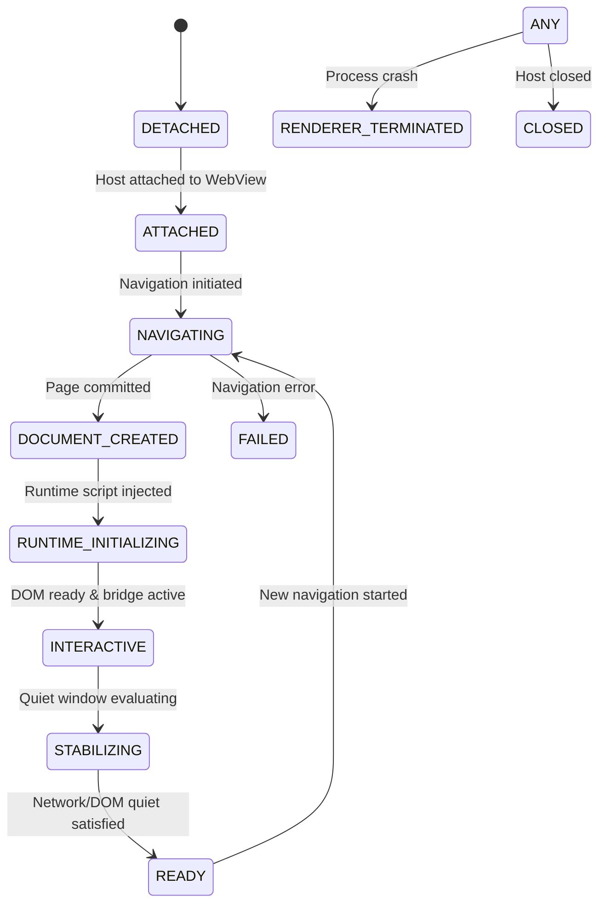

# Lifecycle and event streams

An `AgenticBrowserSession` exposes two streams representing its lifecycle:
1. `session.state: StateFlow<BrowserSessionState>`: The current phase, document identity, DOM revision, and URL.
2. `session.events: Flow<BrowserEvent>`: A reactive stream of lifecycle transitions, DOM mutations, and host-authority notifications.

---

## StateFlow: BrowserSessionState & 11 Phases

The session state data class contains:
```kotlin
data class BrowserSessionState(
    val phase: BrowserSessionPhase,
    val documentId: DocumentId? = null,
    val revision: ObservationRevision = ObservationRevision(0),
    val url: String? = null,
)
```

### The 11 Lifecycle Phases



| Phase | Description | Actions Allowed |
| --- | --- | --- |
| `DETACHED` | Initial phase. Host created but WebView is not yet attached to window or session. | None |
| `ATTACHED` | WebView attached and initialized. Ready to accept initial navigation. | `navigate` |
| `NAVIGATING` | Page request sent; old document cancelled; awaiting new page commit. | Wait, cancel |
| `DOCUMENT_CREATED` | Android WebView has committed the new document. Document ID allocated. | Wait |
| `RUNTIME_INITIALIZING` | TypeScript agentic runtime injected; JavaScript bridge handshaking. | Wait |
| `INTERACTIVE` | DOM is interactive; scripts running. Protocol bridge confirmed active. | `observe`, `await` |
| `STABILIZING` | Page is waiting for active network requests and DOM mutations to subside. | `observe`, `await` |
| `READY` | Page has satisfied quiet window requirements and is stabilized. | `observe`, `execute`, `await`, `navigate` |
| `FAILED` | Terminal navigation error occurred (e.g. SSL failure, DNS failure, blocked policy). | `navigate`, `close` |
| `RENDERER_TERMINATED` | WebView render process was killed by Android OS (OOM or crash). | `close` (must recreate host) |
| `CLOSED` | Session explicitly closed via `host.close()`. All resources freed. | None |

---

## Reactive Event Stream: 11 BrowserEvent Types

The `session.events` Flow emits fine-grained lifecycle and security occurrences:

| Event Type | Payload Properties | When Emitted |
| --- | --- | --- |
| `BrowserEvent.StateChanged` | `val previous: BrowserSessionState`, `val current: BrowserSessionState` | Whenever session transitions between any of the 11 phases. |
| `BrowserEvent.DocumentRevisionChanged` | `val documentId: DocumentId`, `val revision: ObservationRevision` | DOM mutation observer detected additions, removals, or attribute changes. **Cached element references should be refreshed**. |
| `BrowserEvent.PopupRequested` | `val url: String?`, `val isUserGesture: Boolean` | Webpage called `window.open` or targeted a new window (`target="_blank"`). |
| `BrowserEvent.DialogRequested` | `val type: DialogType`, `val message: String`, `val defaultValue: String?` | Webpage triggered `alert()`, `confirm()`, `prompt()`, or `beforeunload`. |
| `BrowserEvent.DownloadRequested` | `val url: String`, `val mimeType: String?`, `val contentLength: Long?` | Webpage triggered a file download navigation. |
| `BrowserEvent.PermissionRequested` | `val origin: String`, `val resources: List<String>` | Webpage requested permissions (e.g., geolocation, microphone, camera). |
| `BrowserEvent.FileChooserRequested` | `val acceptTypes: List<String>`, `val captureEnabled: Boolean` | `<input type="file">` was clicked and requested local file access. |
| `BrowserEvent.NavigationBlocked` | `val url: String`, `val reason: String` | Navigation request was blocked by `NavigationPolicy` rules. |
| `BrowserEvent.SslErrorReceived` | `val url: String`, `val primaryError: Int` | HTTPS certificate validation failed. |
| `BrowserEvent.SafeBrowsingHit` | `val url: String`, `val threatType: Int` | Android WebView Safe Browsing detected malware, phishing, or harmful content. |
| `BrowserEvent.RendererTerminated` | `val didCrash: Boolean` | Render process crashed or was terminated by Android OS low-memory killer. |

---

## Practical event observation recipe

```kotlin
lifecycleScope.launch {
    repeatOnLifecycle(Lifecycle.State.STARTED) {
        host.session.events.collect { event ->
            when (event) {
                is BrowserEvent.StateChanged -> {
                    println("Phase change: ${event.previous.phase} -> ${event.current.phase}")
                    if (event.current.phase == BrowserSessionPhase.READY) {
                        println("Page fully ready at: ${event.current.url}")
                    }
                }

                is BrowserEvent.DocumentRevisionChanged -> {
                    // Critical for autonomous agents: invalidate element reference caches!
                    println("DOM mutated on doc ${event.documentId.value}: rev is now ${event.revision.value}")
                }

                is BrowserEvent.NavigationBlocked -> {
                    println("Warning: Navigation blocked to ${event.url} - ${event.reason}")
                }

                is BrowserEvent.RendererTerminated -> {
                    if (event.didCrash) {
                        println("Fatal: WebView renderer process crashed.")
                    } else {
                        println("Notice: WebView renderer terminated by OS (e.g. OOM killer).")
                    }
                    // Recovery action: recreate AgenticBrowserHost
                }

                else -> Unit
            }
        }
    }
}
```

---

## Cancellation & Teardown Semantics

1. **Serialized Navigation**: Starting a new navigation immediately cancels all pending operations (commands, observations, awaits) bound to the previous document.
2. **Coroutine Cancellation**: Cancelling the coroutine invoking `navigate`, `observe`, or `execute` stops waiting for response envelopes and releases pending request registrations in the Kotlin bridge.
3. **Session Teardown (`host.close()`)**:
   - Idempotent and thread-safe.
   - Clears pending requests and fails them with `BrowserError.SessionClosed`.
   - Detaches JavaScript interface and runtime listeners.
   - Releases hardware screenshot resources.
   - If created via `AgenticBrowserHost.create()`, destroys the underlying WebView. If created via `AgenticBrowserHost.attach()`, detaches without destroying the host-owned WebView.

---

## Related documentation

- [Android Views integration](views.md)
- [Jetpack Compose integration](compose.md)
- [Diagnostics & Error catalog](diagnostics.md)
- [Command reference](commands.md)
