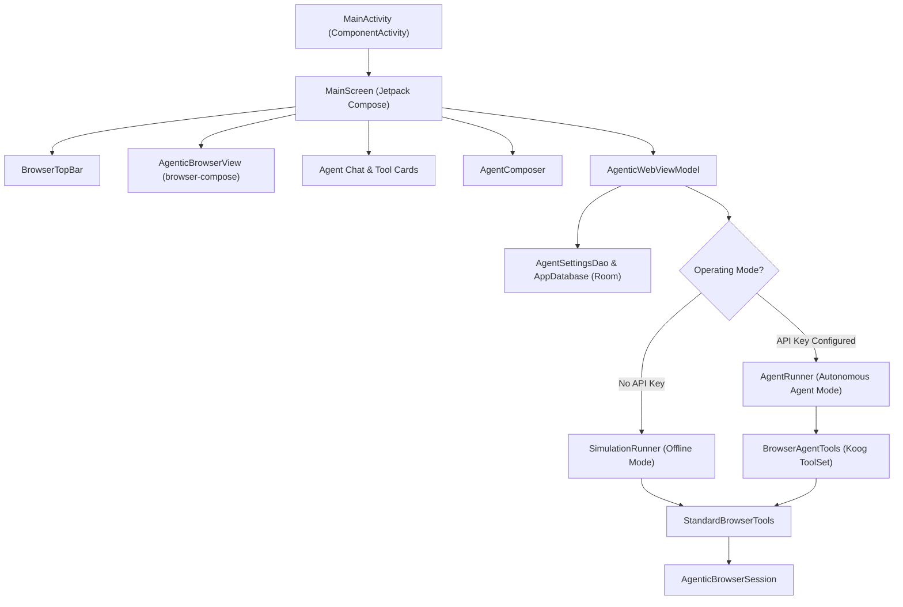

# Sample application guide

The repository includes a complete reference implementation in `samples/android` demonstrating how to build an autonomous browsing assistant on Android using Jetpack Compose and Agentic WebView.

---

## Architecture and UI Design

The sample app implements a split-screen interface:
- **Upper Section**: Real-time rendering of the `AgenticBrowserView` accompanied by `BrowserTopBar` displaying active navigation URLs, connection status, session phase, and settings dialog trigger.
- **Lower Section**: Interactive conversational agent interface featuring:
  - `ChatMessageBubble`: Chronological user and agent dialogue.
  - `ToolCallCard`: Collapsible cards displaying individual browser tool invocations, input arguments, and formatted JSON execution results.
  - `ReasoningSection`: Collapsible panel streaming the model's internal thinking and rationale.
  - `AgentComposer`: Text input field and action button to issue natural language browsing tasks.



---

## Operating Modes

### 1. Offline Simulation Mode (`SimulationRunner`)

When launched without configuring an LLM API key, the application operates in **Offline Simulation Mode**.

- **No external network or API key required**: Ideal for UI layout validation, CI/CD testing, and quick demonstrations.
- **Deterministic Heuristics**: Inspects the user's prompt text to trigger realistic browsing workflows:
  - Prompts containing `"duckduckgo"`, `"google"`, or `"wiki"` trigger multi-step navigation (`browser_navigate`) followed by semantic DOM tree capture (`browser_observe`).
  - Prompts containing `"scroll"` invoke viewport scrolling (`browser_scroll`).
  - Prompts containing `"inspect"`, `"observe"`, or `"tree"` invoke DOM inspection (`browser_observe`).
- **Simulated Reasoning & Streaming**: Generates artificial thinking delays (`onThinkingChanged`, `onThoughtUpdate`) and reports tool start/completion/failure to the UI, providing an authentic agent feel.

---

### 2. Autonomous Agent Mode (`AgentRunner`)

When provided with an API key, the application switches to **Autonomous Agent Mode**, powered by the [JetBrains Koog](koog.md) framework.

- **Configurable LLM Endpoint**: Through `SettingsSheet`, configure:
  - **API Key**: Secret token for authentication.
  - **Base URL**: Defaults to `https://api.openai.com`, or custom endpoints (Ollama, vLLM, OpenRouter).
  - **Model Name**: Defaults to `gpt-4o`.
- **Iterative Decision Loop**:
  1. The LLM receives the system prompt instructing it to explore via `browser_observe`.
  2. Extracts actionable `ElementRef` tokens (`documentId`, `frameId`, `elementId`, `observedAtRevision`).
  3. Dispatches targeted interactions (`browser_click`, `browser_type_text`, `browser_select_option`).
  4. Automatically observes updated DOM revisions until the user's objective is satisfied.
- **Reasoning Display**: Extracts `MessagePart.Reasoning` chunks from model responses and renders them inside `ReasoningSection`.

---

## Building and Running the Sample

### Prerequisites:
- Android Studio Ladybug or newer
- Android SDK with Platform 34+
- Android device or emulator running API 28+

### Compile debug APK:
```bash
./gradlew :samples:android:assembleDebug
```

### Install onto device or emulator:
```bash
./gradlew :samples:android:installDebug
```

---

## Automated Unit Testing

The sample application includes comprehensive unit test coverage:

```bash
./gradlew :samples:android:testDebugUnitTest
```

- **`SimulationRunnerTest`**: Validates deterministic tool invocation sequences and prompt heuristics.
- **`BrowserAgentToolsTest`**: Validates reflection-based method invocations and JSON argument mapping.
- **`AgenticWebViewModelTest`**: Tests state emission, database settings observation, and tool tracking.

---

## Related documentation

- [Getting started](getting-started.md)
- [Jetpack Compose integration](compose.md)
- [Koog agent integration](koog.md)
- [Framework-neutral agent tools](agent-tools.md)
- [Sample module README](../samples/android/README.md)
